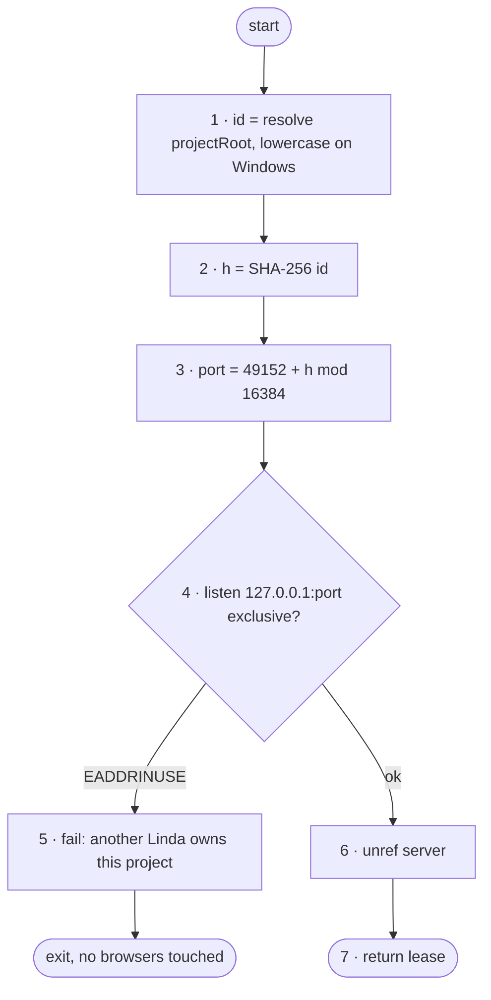

# FC-001 — Single-instance lease

| | |
|---|---|
| Algorithm | [ALG-001](../03-algorithms/ALG-001-single-instance-lease.md) |
| Problem | [PS-001](../02-problems/PROBLEM_REGISTER.md) |

Node numbers match the step numbers in ALG-001. Rounded nodes are terminals; diamonds are decisions.

