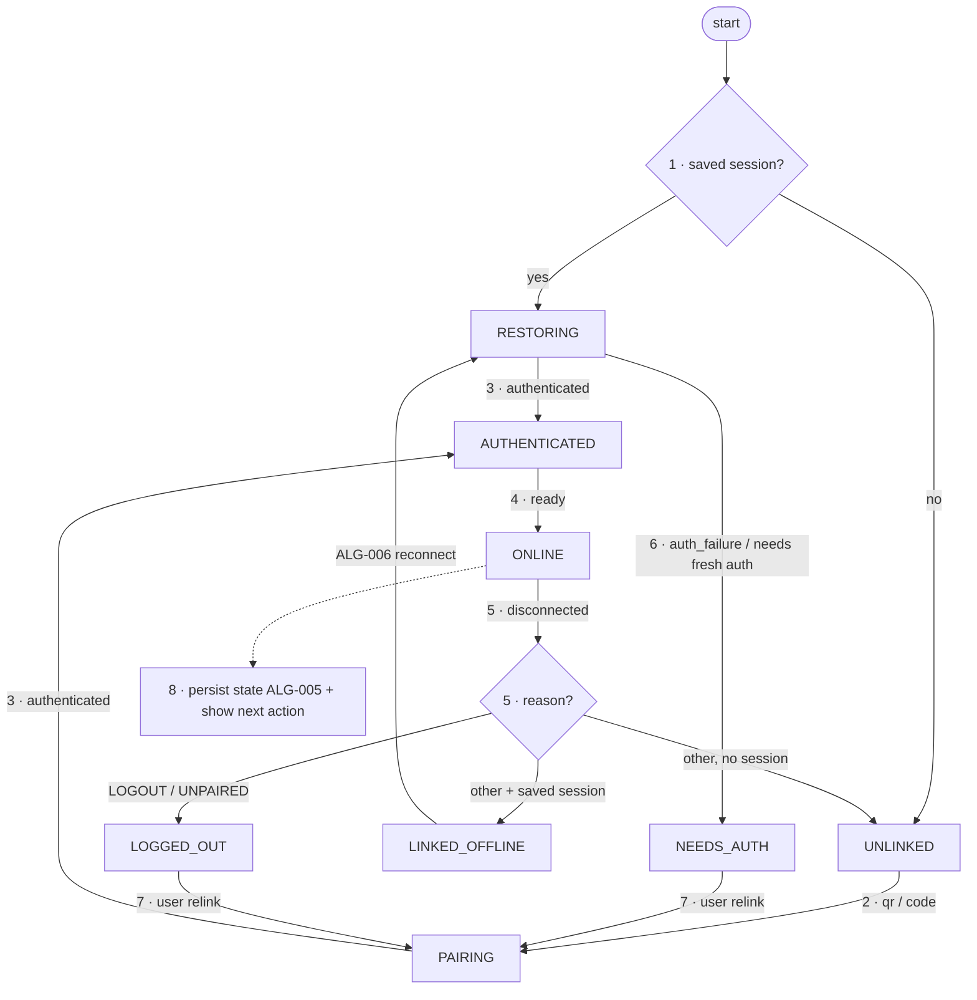

# FC-002 — Connection state machine

| | |
|---|---|
| Algorithm | [ALG-002](../03-algorithms/ALG-002-connection-state-machine.md) |
| Problem | [PS-002](../02-problems/PROBLEM_REGISTER.md) |

Node numbers match the step numbers in ALG-002. Rounded nodes are terminals; diamonds are decisions.

