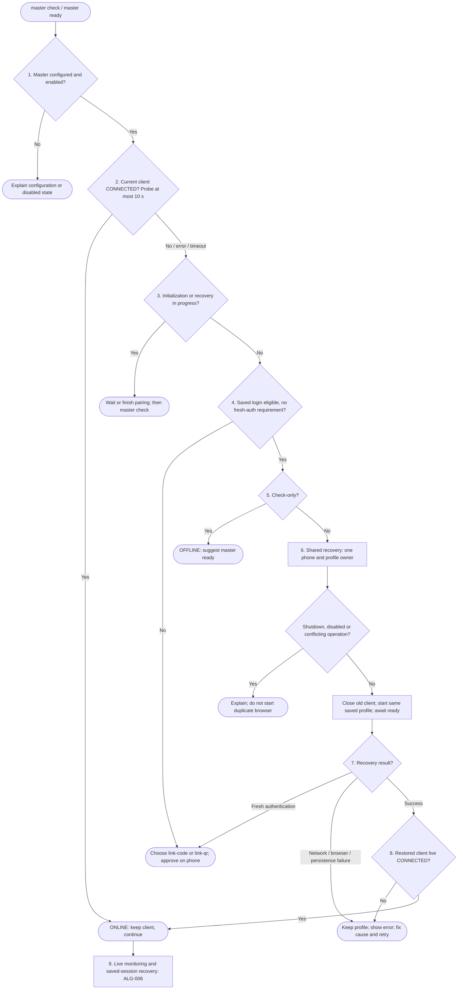

# FC-003 - Master readiness and restore-first recovery

| | |
|---|---|
| Algorithm | [ALG-003](../03-algorithms/ALG-003-master-restore.md) |
| Problem | [PS-003](../02-problems/PROBLEM_REGISTER.md) |

Step numbers match ALG-003. Linking evidence, local login and live connection
are separate facts. A failed live check is not proof of logout.

The coordinator releases operation/profile ownership on success or failure.
Automatic cooldown retries do not force QR/code or resume an intentional pause.
