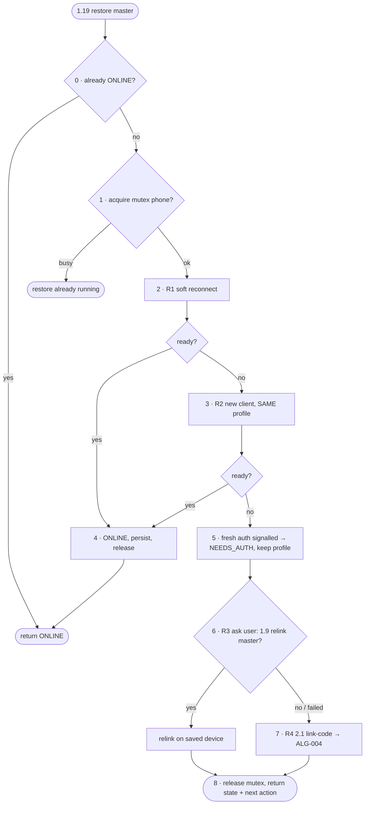

# FC-003 — Master restore ladder

| | |
|---|---|
| Algorithm | [ALG-003](../03-algorithms/ALG-003-master-restore.md) |
| Problem | [PS-003](../02-problems/PROBLEM_REGISTER.md) |

Node numbers match the step numbers in ALG-003. Rounded nodes are terminals; diamonds are decisions.

