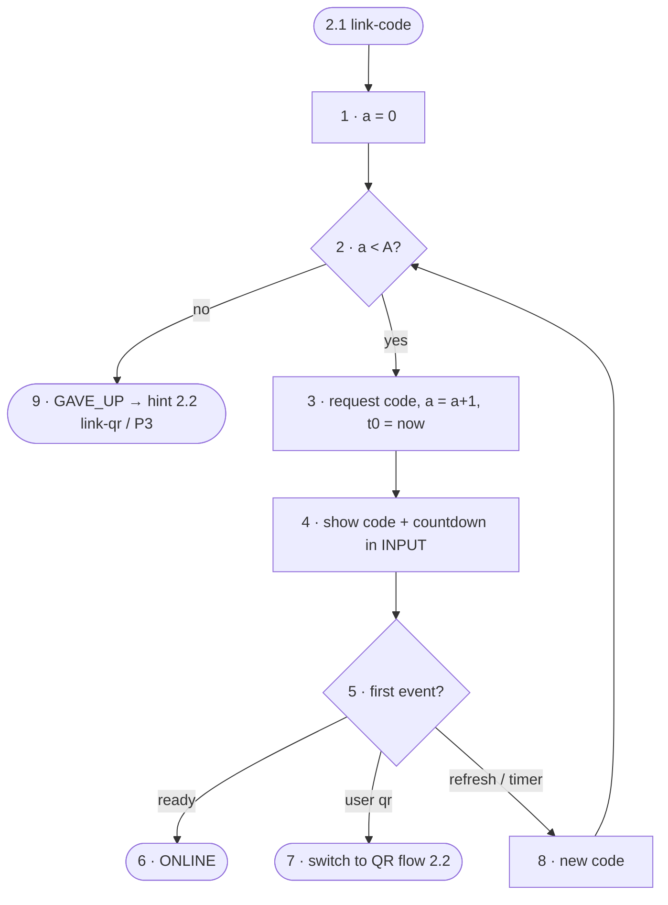

# FC-004 — Pairing code refresh

| | |
|---|---|
| Algorithm | [ALG-004](../03-algorithms/ALG-004-pairing-code-refresh.md) |
| Problem | [PS-004](../02-problems/PROBLEM_REGISTER.md) |

Node numbers match the step numbers in ALG-004. Rounded nodes are terminals; diamonds are decisions.

