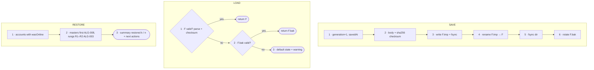

# FC-005 — Durable session store

| | |
|---|---|
| Algorithm | [ALG-005](../03-algorithms/ALG-005-durable-session-store.md) |
| Problem | [PS-005](../02-problems/PROBLEM_REGISTER.md) |

Node numbers match the step numbers in ALG-005. Rounded nodes are terminals; diamonds are decisions.

