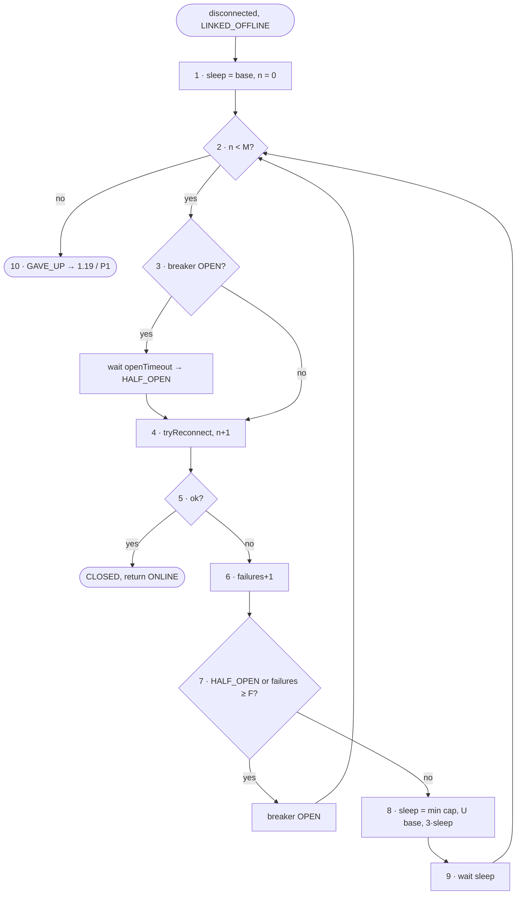

# FC-006 — Reconnect backoff with circuit breaker

| | |
|---|---|
| Algorithm | [ALG-006](../03-algorithms/ALG-006-reconnect-backoff.md) |
| Problem | [PS-006](../02-problems/PROBLEM_REGISTER.md) |

Node numbers match the step numbers in ALG-006. Rounded nodes are terminals; diamonds are decisions.

