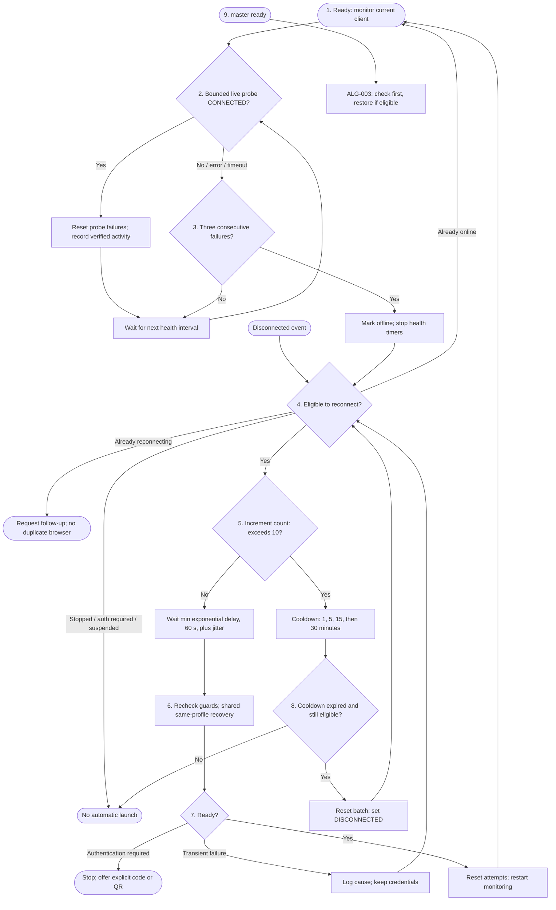

# FC-006 - Live monitoring, retry batches and cooldown

| | |
|---|---|
| Algorithm | [ALG-006](../03-algorithms/ALG-006-reconnect-backoff.md) |
| Problem | [PS-006](../02-problems/PROBLEM_REGISTER.md) |

Cooldown is not permanent failure. An explicit local disconnect cancels owned
timers; logout never enters an automatic QR/code loop.
