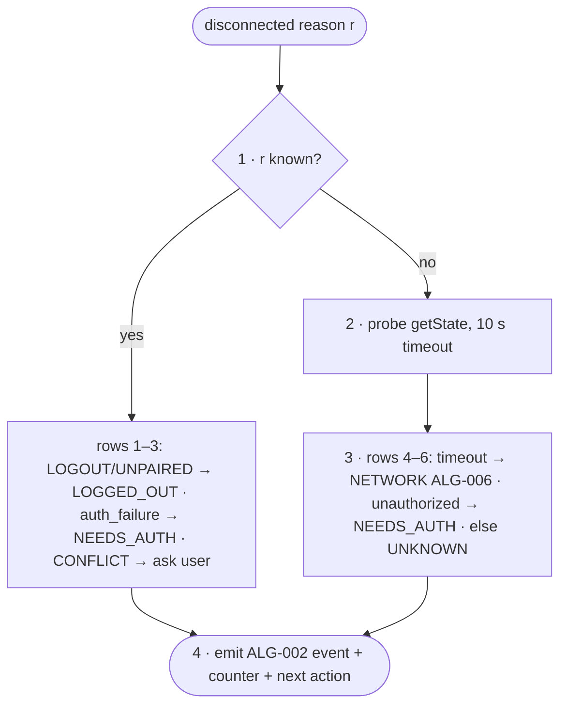

# FC-007 — Logout detection

| | |
|---|---|
| Algorithm | [ALG-007](../03-algorithms/ALG-007-logout-detection.md) |
| Problem | [PS-007](../02-problems/PROBLEM_REGISTER.md) |

Node numbers match the step numbers in ALG-007. Rounded nodes are terminals; diamonds are decisions.

