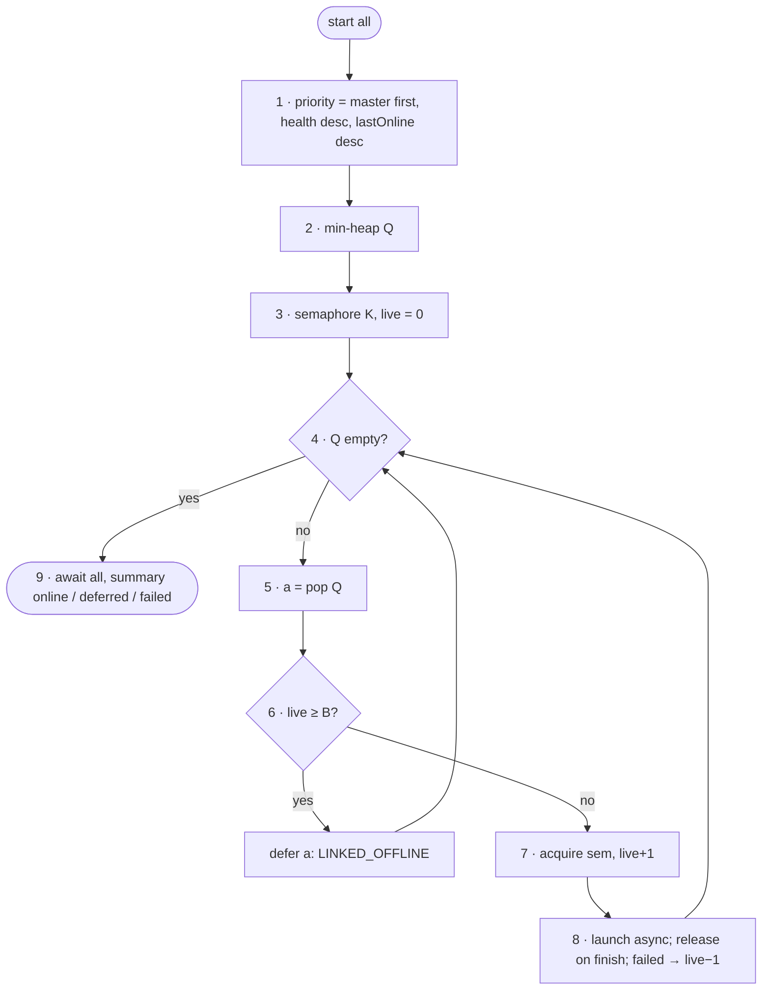

# FC-008 — Multi-account orchestration

| | |
|---|---|
| Algorithm | [ALG-008](../03-algorithms/ALG-008-multi-account-orchestration.md) |
| Problem | [PS-008](../02-problems/PROBLEM_REGISTER.md) |

Node numbers match the step numbers in ALG-008. Rounded nodes are terminals; diamonds are decisions.

