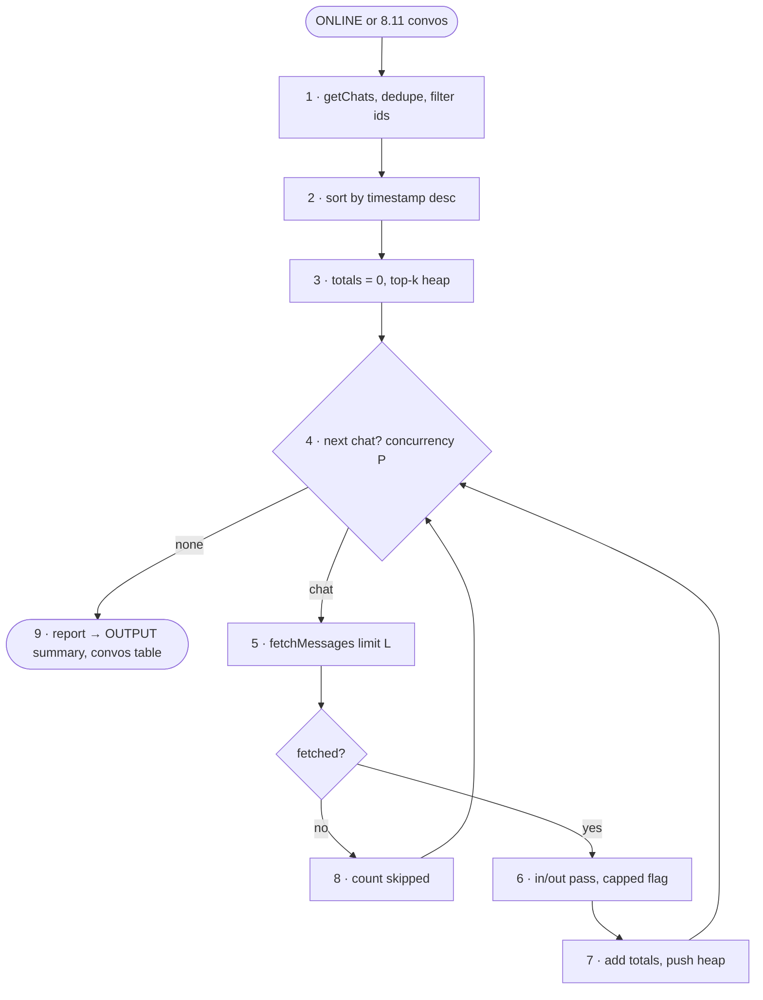

# FC-009 — Conversation report

| | |
|---|---|
| Algorithm | [ALG-009](../03-algorithms/ALG-009-conversation-report.md) |
| Problem | [PS-009](../02-problems/PROBLEM_REGISTER.md) |

Node numbers match the step numbers in ALG-009. Rounded nodes are terminals; diamonds are decisions.

