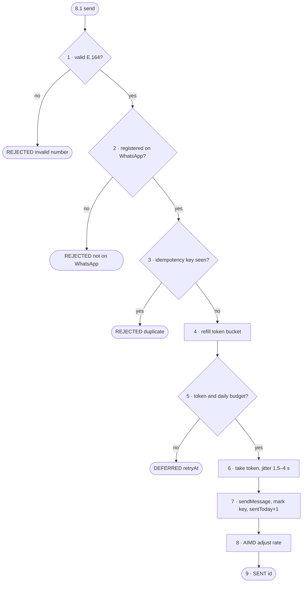

# FC-010 — Safe send

| | |
|---|---|
| Algorithm | [ALG-010](../03-algorithms/ALG-010-safe-send.md) |
| Problem | [PS-010](../02-problems/PROBLEM_REGISTER.md) |

Node numbers match the step numbers in ALG-010. Rounded nodes are terminals; diamonds are decisions.

