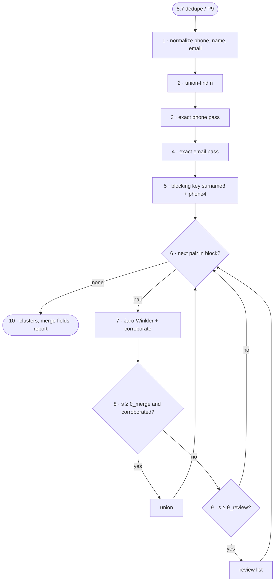

# FC-011 — Contact deduplication

| | |
|---|---|
| Algorithm | [ALG-011](../03-algorithms/ALG-011-contact-dedup.md) |
| Problem | [PS-011](../02-problems/PROBLEM_REGISTER.md) |

Node numbers match the step numbers in ALG-011. Rounded nodes are terminals; diamonds are decisions.

