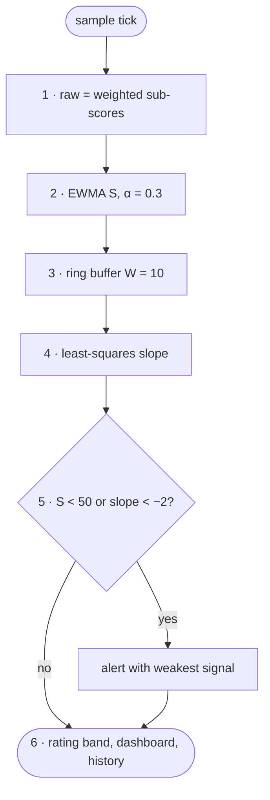

# FC-012 — Health score

| | |
|---|---|
| Algorithm | [ALG-012](../03-algorithms/ALG-012-health-score.md) |
| Problem | [PS-012](../02-problems/PROBLEM_REGISTER.md) |

Node numbers match the step numbers in ALG-012. Rounded nodes are terminals; diamonds are decisions.

