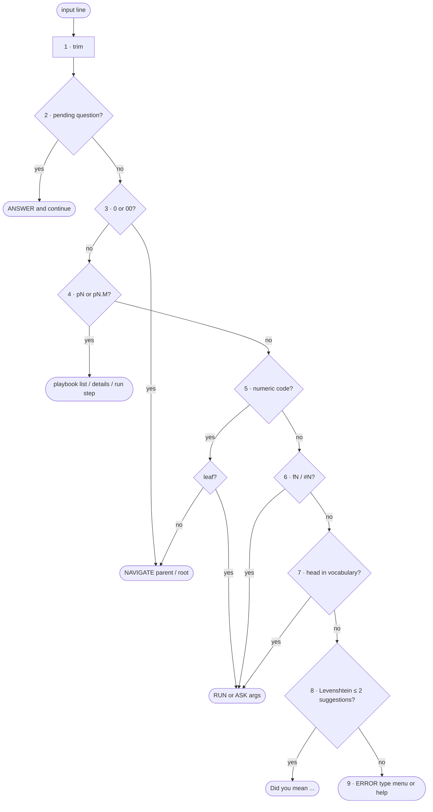

# FC-013 — Command resolution

| | |
|---|---|
| Algorithm | [ALG-013](../03-algorithms/ALG-013-command-resolution.md) |
| Problem | [PS-013](../02-problems/PROBLEM_REGISTER.md) |

Node numbers match the step numbers in ALG-013. Rounded nodes are terminals; diamonds are decisions.

