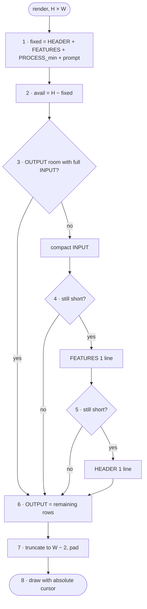

# FC-014 — Screen budget layout

| | |
|---|---|
| Algorithm | [ALG-014](../03-algorithms/ALG-014-screen-budget.md) |
| Problem | [PS-014](../02-problems/PROBLEM_REGISTER.md) |

Node numbers match the step numbers in ALG-014. Rounded nodes are terminals; diamonds are decisions.

