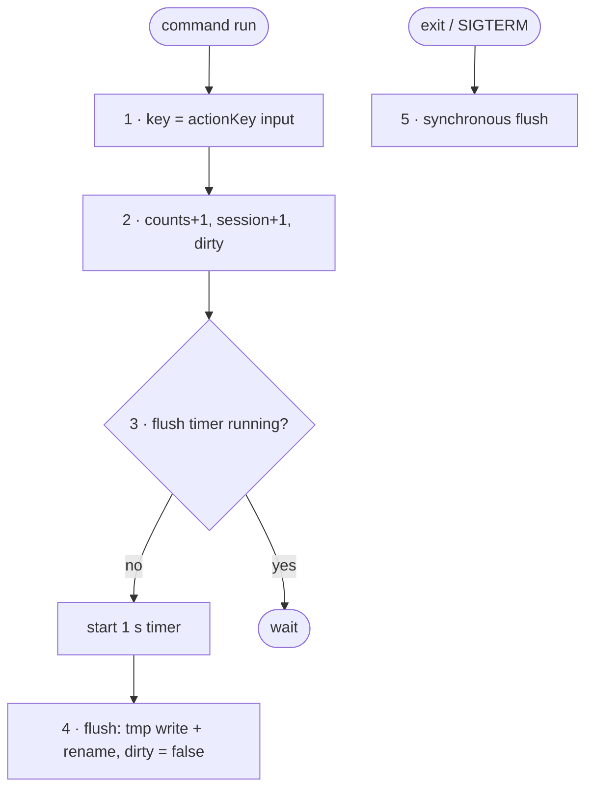

# FC-015 — Usage counters

| | |
|---|---|
| Algorithm | [ALG-015](../03-algorithms/ALG-015-usage-counters.md) |
| Problem | [PS-015](../02-problems/PROBLEM_REGISTER.md) |

Node numbers match the step numbers in ALG-015. Rounded nodes are terminals; diamonds are decisions.

