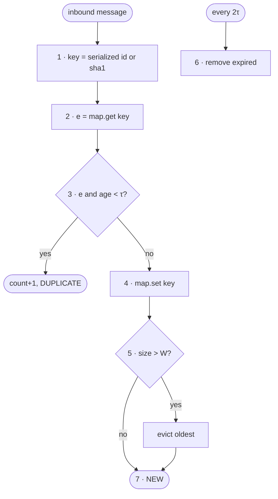

# FC-016 — Inbound deduplication

| | |
|---|---|
| Algorithm | [ALG-016](../03-algorithms/ALG-016-inbound-dedup.md) |
| Problem | [PS-016](../02-problems/PROBLEM_REGISTER.md) |

Node numbers match the step numbers in ALG-016. Rounded nodes are terminals; diamonds are decisions.

