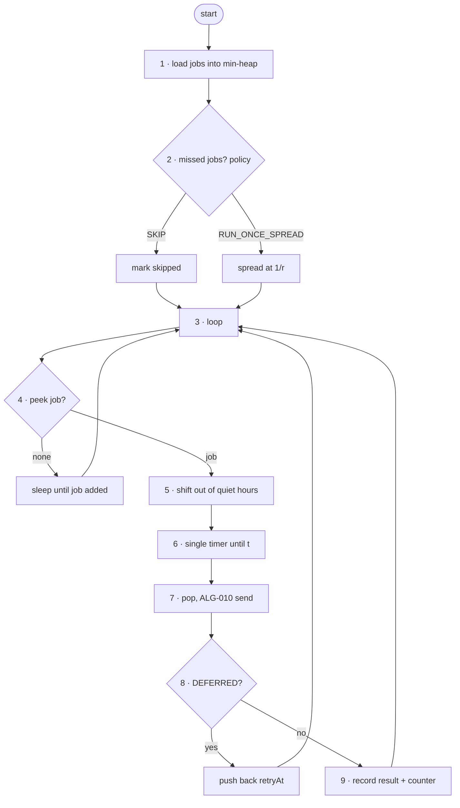

# FC-017 — Campaign scheduler

| | |
|---|---|
| Algorithm | [ALG-017](../03-algorithms/ALG-017-campaign-scheduler.md) |
| Problem | [PS-017](../02-problems/PROBLEM_REGISTER.md) |

Node numbers match the step numbers in ALG-017. Rounded nodes are terminals; diamonds are decisions.

