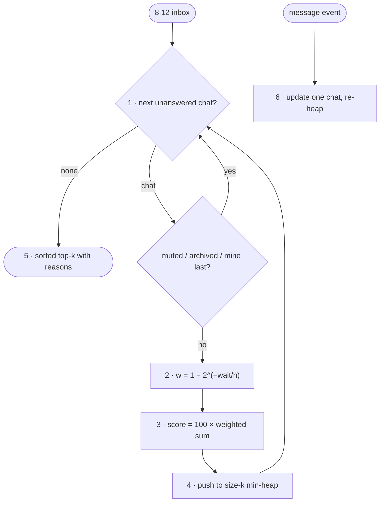

# FC-018 — Priority inbox

| | |
|---|---|
| Algorithm | [ALG-018](../03-algorithms/ALG-018-priority-inbox.md) |
| Problem | [PS-018](../02-problems/PROBLEM_REGISTER.md) |

Node numbers match the step numbers in ALG-018. Rounded nodes are terminals; diamonds are decisions.

