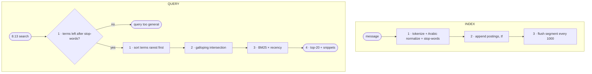

# FC-019 — Full-text search

| | |
|---|---|
| Algorithm | [ALG-019](../03-algorithms/ALG-019-full-text-search.md) |
| Problem | [PS-019](../02-problems/PROBLEM_REGISTER.md) |

Node numbers match the step numbers in ALG-019. Rounded nodes are terminals; diamonds are decisions.

