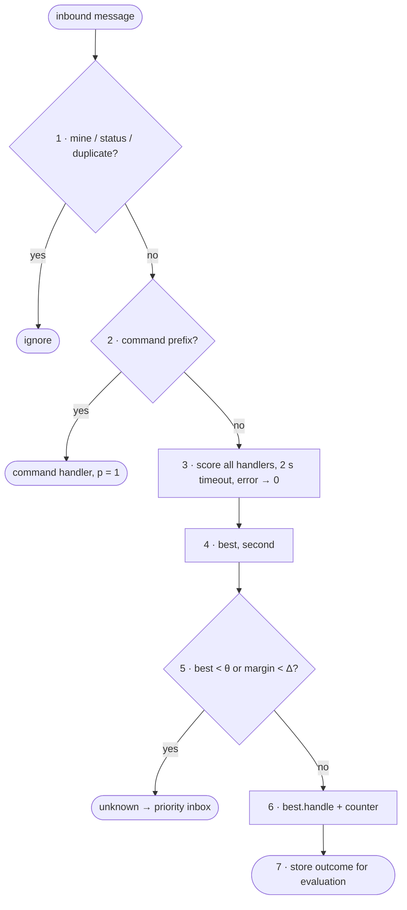

# FC-020 — Intent routing

| | |
|---|---|
| Algorithm | [ALG-020](../03-algorithms/ALG-020-intent-routing.md) |
| Problem | [PS-020](../02-problems/PROBLEM_REGISTER.md) |

Node numbers match the step numbers in ALG-020. Rounded nodes are terminals; diamonds are decisions.

