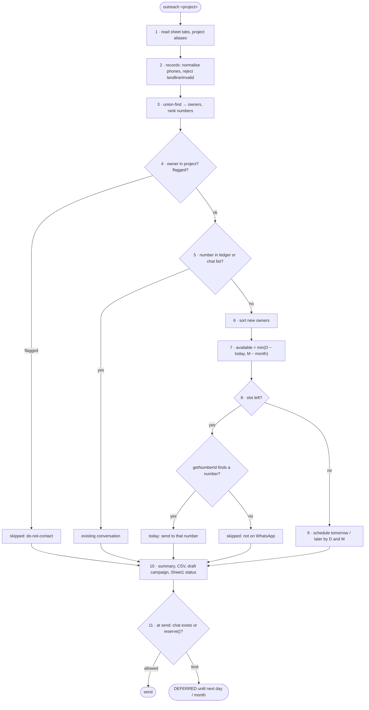

# FC-021 — Area owner outreach

| | |
|---|---|
| Algorithm | [ALG-021](../03-algorithms/ALG-021-area-owner-outreach.md) |
| Problem | [PS-021](../02-problems/PROBLEM_REGISTER.md) |

Node numbers match the step numbers in ALG-021. Rounded nodes are terminals; diamonds are decisions.

