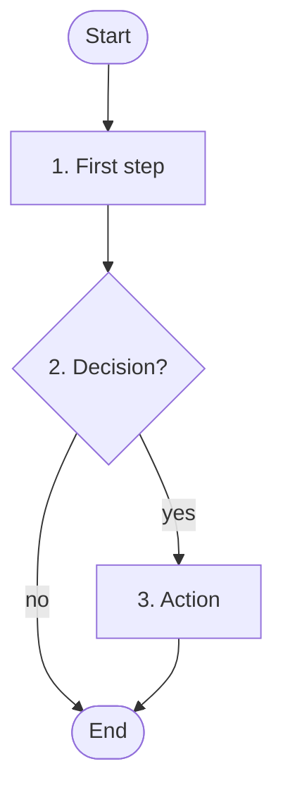

# FC-nnn — <Title>

Flowchart of [ALG-nnn](../03-algorithms/ALG-nnn-slug.md). The step numbers
in the boxes match the algorithm.

Shapes: `([ ])` start or end · `[ ]` step · `{ }` decision · `[/ /]` input
or output · `[( )]` storage.
